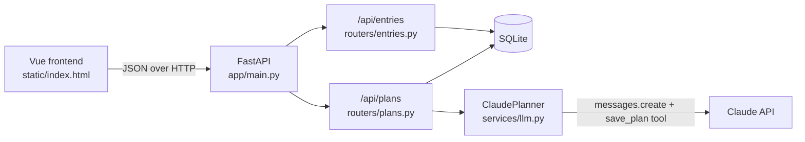

# Smart Journal

A journaling app with an LLM planner. Write daily entries, then turn your ideas and recent entries into a realistic plan for the week or the weekend, generated with the Claude API.


## Features

- **Journal:** create, edit, search and delete entries, with an optional mood.
- **Planner:** choose "this week" or "this weekend", add ideas, pick journal entries for context, and get a day-by-day plan with a focus and a few small tasks per day.
- **Need inspiration?** A "Suggest something to do" button offers a random activity (a walk, a hike, seeing friends) that you can add to your ideas in one click.
- **Plan history:** every generated plan is saved so you can come back to it.

## Tech stack

| Layer | Choice |
|---|---|
| Backend | Python 3.12, FastAPI |
| Database | SQLite through SQLAlchemy 2.0 (swappable for PostgreSQL via `DATABASE_URL`) |
| Validation | Pydantic v2 |
| LLM | Claude API (Anthropic Python SDK) with tool use for structured output |
| Frontend | Vue 3 (loaded from a CDN, no build step), served by FastAPI |
| Testing | pytest with FastAPI's TestClient |
| Delivery | Docker, GitHub Actions CI |

## Architecture



```
app/
  main.py          app setup, routers, static frontend
  config.py        settings from environment variables
  database.py      engine, sessions, get_db dependency
  models.py        SQLAlchemy tables: Entry, Plan
  schemas.py       Pydantic request and response models
  routers/         HTTP endpoints
  services/llm.py  prompt building and the Claude integration
static/index.html  the frontend
tests/             pytest suite (no real API calls)
```

## Design decisions

**Structured output through tool use.** Instead of asking the model for JSON in free text and hoping it parses, the planner forces Claude to call a `save_plan` tool whose input schema matches the `PlanContent` model. The result is then validated with Pydantic. If the model returns the wrong shape or no tool call, the API returns a clear 502 and nothing is saved.

**User text is treated as data, not instructions.** Journal entries and ideas are wrapped in `<journal_entries>` and `<ideas>` tags, and the system prompt tells the model to treat them as material to plan from. This reduces the risk of prompt injection from user content. Entries are also truncated to keep prompts a predictable size.

**The LLM is behind an interface, so it can be tested without the network.** `create_plan` depends on a `Planner` protocol supplied through FastAPI's dependency injection. Tests swap in a fake planner, and `ClaudePlanner` takes its client as a constructor argument so its response handling can be tested with a fake client. The test suite never calls the real API, so it's fast, free and reliable in CI.

**Failure modes have clear status codes.**

| Situation | Status |
|---|---|
| Invalid input (empty title, unknown mood, nothing to plan from) | 422 |
| Entry or chosen entry doesn't exist | 404 |
| No API key configured | 503 |
| Claude API error or unusable response | 502 |

**Basic security.** The API key is read from the environment and never committed (`.env` is git-ignored). Search uses SQLAlchemy bound parameters, so input can't inject SQL (there's a test for this). The Docker image runs as a non-root user.

## Run it locally

You'll need Python 3.12 and an Anthropic API key for the planner. The journal works without a key.

```bash
git clone https://github.com/YOUR-USERNAME/smart-journal.git
cd smart-journal
python -m venv .venv
source .venv/bin/activate        # Windows: .venv\Scripts\activate
pip install -r requirements.txt -r requirements-dev.txt
cp .env.example .env             # then add your ANTHROPIC_API_KEY
uvicorn app.main:app --reload
```

Open http://localhost:8000 for the app and http://localhost:8000/docs for the interactive API docs.

## Run with Docker

```bash
docker build -t smart-journal .
docker run -p 8000:8000 --env-file .env -v journal-data:/app/data smart-journal
```

The named volume keeps your entries when the container is replaced.

## Tests

```bash
pytest -v
```

The suite covers entry CRUD, search (including an SQL-injection attempt), validation errors, the planner endpoints with a fake planner, prompt building, and how `ClaudePlanner` handles good, missing and malformed tool calls. GitHub Actions runs the tests and builds the Docker image on every push and pull request.

## API

| Method | Path | Description |
|---|---|---|
| GET | `/api/entries?q=&limit=` | List entries, newest first, with optional search |
| POST | `/api/entries` | Create an entry |
| GET | `/api/entries/{id}` | Get one entry |
| PATCH | `/api/entries/{id}` | Update only the fields sent |
| DELETE | `/api/entries/{id}` | Delete an entry |
| POST | `/api/plans` | Generate and save a plan |
| GET | `/api/plans` | List recent plans |
| GET | `/api/suggestions/random?exclude=` | A random activity suggestion, skipping the one passed in `exclude` |
| GET | `/api/health` | Health check |

## What I'd add next

- User accounts with JWT authentication, so each person only sees their own entries
- Alembic migrations instead of `create_all`, and PostgreSQL for production
- Streaming the plan as it's generated
- Deployment to Azure Container Apps from the CI pipeline
- A Vite build for the frontend once it grows beyond one page
