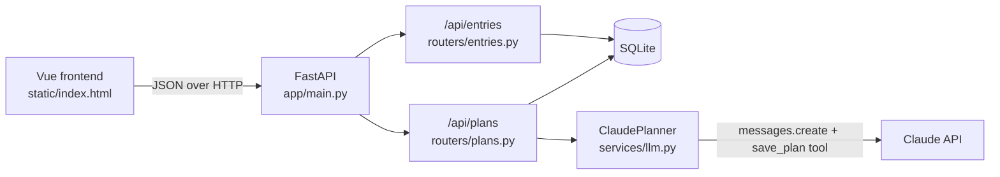

# Smart Journal

A private journaling app with user accounts and an LLM planner. Write daily entries, then turn your ideas and recent entries into a realistic plan for the week or the weekend, generated with the Claude API.


## Features

- **Accounts:** sign up with email and password, verify your email through a link, then log in. Each person only ever sees their own entries and plans.
- **Journal:** create, edit, search and delete entries, with an optional mood.
- **Planner:** choose "this week" or "this weekend", add ideas, pick journal entries for context, and get a day-by-day plan with a focus and a few small tasks per day.
- **Need inspiration?** A "Suggest something to do" button offers a random activity (a walk, a hike, seeing friends) that you can add to your ideas in one click.
- **Plan history:** every generated plan is saved so you can come back to it.

## Tech stack

| Layer | Choice |
|---|---|
| Backend | Python 3.12, FastAPI |
| Database | SQLite through SQLAlchemy 2.0 (swappable for PostgreSQL via `DATABASE_URL`) |
| Validation | Pydantic v2 |
| Auth | bcrypt password hashing, JWT access tokens, email verification links |
| LLM | Claude API (tool use) or Gemini API (JSON schema), chosen with `LLM_PROVIDER` |
| Frontend | Vue 3 (loaded from a CDN, no build step), served by FastAPI |
| Testing | pytest with FastAPI's TestClient |
| Delivery | Docker, GitHub Actions CI |

## Architecture



```
app/
  main.py          app setup, routers, static frontend
  config.py        settings from environment variables
  database.py      engine, sessions, get_db dependency
  models.py        SQLAlchemy tables: Entry, Plan
  schemas.py       Pydantic request and response models
  routers/         HTTP endpoints
  services/llm.py  prompt building and the Claude integration
static/index.html  the frontend
tests/             pytest suite (no real API calls)
```

## Design decisions

**Accounts and verification.** Passwords are hashed with bcrypt and never stored or returned. Logging in returns a short-lived JWT access token, which the frontend sends as `Authorization: Bearer <token>`. Sign-up sends a verification link containing a separate signed token that expires after 24 hours; each token carries a `purpose`, so a verification token can't be used as a login token or the other way round. Unverified users can't log in.

**Password reset.** "Forgot password?" emails a link with a signed token that expires after 30 minutes. Reset and login tokens carry a fingerprint of the current password hash, so once the password changes, the link stops working (it's single-use) and every existing session is logged out. Asking for a reset always gets the same reply, whether or not the email has an account.

**Privacy between users.** Every entry and plan has a `user_id`, and every query filters by the logged-in user. Asking for someone else's entry returns the same 404 as a missing one, so ids can't be probed. Tests check this for read, update, delete and planning.

**Not leaking who has an account.** A wrong password and an unknown email return the same 401 message, and the unknown-email path still runs a bcrypt check so both take the same time. Resending a verification link always returns the same reply.

**Email in development.** Emails go through an `EmailSender` interface. The default prints them to the server terminal, so you can click the verification link locally; a real provider is one more class.

**Structured output through tool use.** Instead of asking the model for JSON in free text and hoping it parses, the planner forces Claude to call a `save_plan` tool whose input schema matches the `PlanContent` model. The result is then validated with Pydantic. If the model returns the wrong shape or no tool call, the API returns a clear 502 and nothing is saved.

**User text is treated as data, not instructions.** Journal entries and ideas are wrapped in `<journal_entries>` and `<ideas>` tags, and the system prompt tells the model to treat them as material to plan from. This reduces the risk of prompt injection from user content. Entries are also truncated to keep prompts a predictable size.

**Swappable LLM providers.** `ClaudePlanner` and `GeminiPlanner` implement the same `Planner` interface, so switching providers is one setting in `.env` (`LLM_PROVIDER=claude` or `gemini`). Each uses its provider's native structured-output feature, and both results are validated against the same Pydantic model.

**Retries with exponential backoff.** When Gemini is overloaded or rate-limited (429, 5xx), the planner waits 1s and then 2s and tries again before giving up, and the user sees a friendly "busy, try again" message rather than a status code. Errors that retrying can't fix, such as a bad key, fail immediately. The Anthropic SDK has the same behaviour built in. Tests inject a fake `sleep`, so they run instantly.

**The LLM is behind an interface, so it can be tested without the network.** `create_plan` depends on a `Planner` protocol supplied through FastAPI's dependency injection. Tests swap in a fake planner, and `ClaudePlanner` takes its client as a constructor argument so its response handling can be tested with a fake client. The test suite never calls the real API, so it's fast, free and reliable in CI.

**Failure modes have clear status codes.**

| Situation | Status |
|---|---|
| Invalid input (empty title, unknown mood, nothing to plan from) | 422 |
| Entry or chosen entry doesn't exist | 404 |
| No API key configured | 503 |
| Claude API error or unusable response | 502 |

**Basic security.** The API key is read from the environment and never committed (`.env` is git-ignored). Search uses SQLAlchemy bound parameters, so input can't inject SQL (there's a test for this). The Docker image runs as a non-root user.

## Run it locally

You'll need Python 3.12 and an Anthropic API key for the planner. The journal works without a key.

```bash
git clone https://github.com/YOUR-USERNAME/smart-journal.git
cd smart-journal
python -m venv .venv
source .venv/bin/activate        # Windows: .venv\Scripts\activate
pip install -r requirements.txt -r requirements-dev.txt
cp .env.example .env             # then add an LLM key and a SECRET_KEY
uvicorn app.main:app --reload
```

Create an account, then copy the verification link that's printed in the terminal into your browser. Open http://localhost:8000 for the app and http://localhost:8000/docs for the interactive API docs.

## Run with Docker

```bash
docker build -t smart-journal .
docker run -p 8000:8000 --env-file .env -v journal-data:/app/data smart-journal
```

The named volume keeps your entries when the container is replaced.

## Deploy (Render, free tier)

1. On render.com, create a **PostgreSQL** database (Free) and copy its **Internal Database URL**.
2. Create a **Web Service** from this GitHub repo. Render detects the Dockerfile. Choose the Free instance type.
3. Add environment variables: `DATABASE_URL` (from step 1), `SECRET_KEY`, `LLM_PROVIDER`, the matching API key and model, and `APP_BASE_URL` set to the service's `https://….onrender.com` address.
4. Optionally add the `SMTP_*` variables so verification emails are really sent. Without them, the links appear in the service's **Logs** tab.

Free services sleep after 15 minutes without traffic, so the first visit after a break takes up to a minute.

## Tests

```bash
pytest -v
```

The suite covers sign-up, verification, login, expired and forged tokens, privacy between users, entry CRUD, search (including an SQL-injection attempt), validation errors, the planner endpoints with a fake planner, prompt building, and how `ClaudePlanner` handles good, missing and malformed tool calls. GitHub Actions runs the tests and builds the Docker image on every push and pull request.

## API

Everything under `/api/entries` and `/api/plans` needs an `Authorization: Bearer <token>` header. In `/docs`, log in, then click **Authorize** and paste the token.

| Method | Path | Description |
|---|---|---|
| POST | `/api/auth/register` | Create an account and send a verification email |
| POST | `/api/auth/verify` | Verify an email with the token from the link |
| POST | `/api/auth/resend-verification` | Send a new verification link |
| POST | `/api/auth/login` | Log in and get an access token |
| POST | `/api/auth/forgot-password` | Email a password reset link |
| POST | `/api/auth/reset-password` | Set a new password with the token from the link |
| GET | `/api/auth/settings` | Whether real emails are sent (used by the sign-in screen) |
| GET | `/api/auth/me` | The logged-in user |
| GET | `/api/entries?q=&limit=` | List entries, newest first, with optional search |
| POST | `/api/entries` | Create an entry |
| GET | `/api/entries/{id}` | Get one entry |
| PATCH | `/api/entries/{id}` | Update only the fields sent |
| DELETE | `/api/entries/{id}` | Delete an entry |
| POST | `/api/plans` | Generate and save a plan |
| GET | `/api/plans` | List recent plans |
| DELETE | `/api/plans/{id}` | Delete a plan |
| DELETE | `/api/plans/{id}/days/{day}/tasks/{task}` | Remove one task from a plan (returns the updated plan) |
| GET | `/api/suggestions/random?exclude=` | A random activity suggestion, skipping the one passed in `exclude` |
| GET | `/api/health` | Health check |

## What I'd add next

- A domain of my own for email, so messages are less likely to land in spam
- Rate limiting on login and sign-up
- httpOnly cookies instead of localStorage for the token
- Alembic migrations instead of `create_all`, and PostgreSQL for production
- Streaming the plan as it's generated
- Deployment to Azure Container Apps from the CI pipeline
- A Vite build for the frontend once it grows beyond one page
